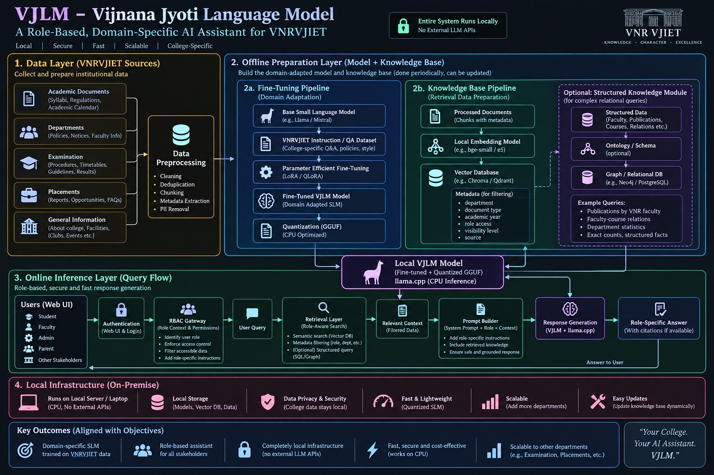
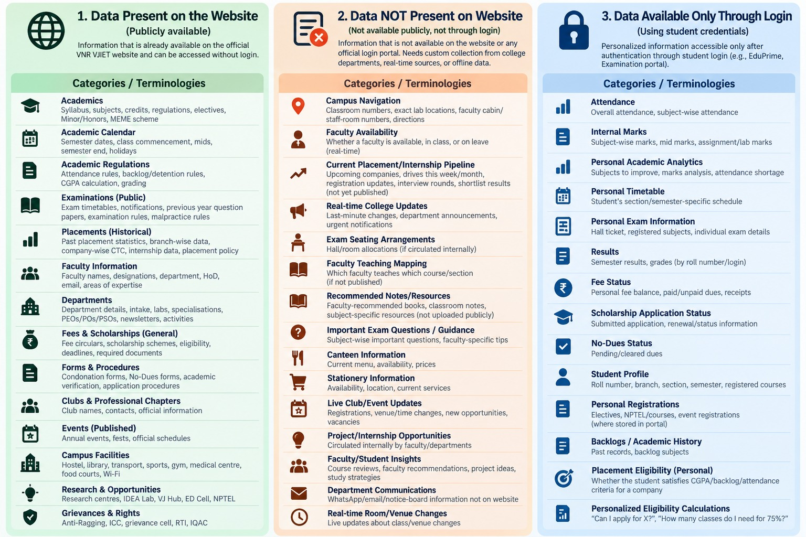

# VJLM — End-to-End Implementation & Decision Plan (Master Plan)

> **Source of truth.** This is the plain-text extraction of
> `VJLM_End_to_End_Implementation_Decision_Plan.docx`, the master plan the whole
> project follows. Everything else in this repo is derived from it:
>
> - [`DECISIONS.md`](../DECISIONS.md) — the decision log this plan mandates
> - [`data_catalog/classification.md`](../data_catalog/classification.md) — Phase 2, applied to the 14 public categories
> - [`experiments/PLAN.md`](../experiments/PLAN.md) — the component comparisons Phases 6–9 require
> - [`HANDOFF.md`](../HANDOFF.md) — current status against these phases
>
> The two figures referenced below are in [`figures/`](figures/):
> **Figure 1** [`architecture.jpg`](figures/architecture.jpg) — the four-layer VJLM architecture.
> **Figure 2** [`data-sources.jpg`](figures/data-sources.jpg) — the three data columns; Phase 1 uses column 1 only.

---

VJLM – End-to-End Implementation & Decision Plan
Vijnana Jyothi Language Model | Local, Role-Aware, Domain-Specific AI Assistant for VNRVJIET
Purpose of this document
This is the master build plan for Desktop AI. It does not blindly select technologies. At every major stage, Desktop AI must research the current options using its inbuilt browser, build a small benchmark on VJLM data, compare alternatives using measurable criteria, record the decision, and only then continue implementation.
Non-negotiable
VJLM requirement
Initial users
Students and faculty.
Initial data scope
Publicly available VNRVJIET website data. Login-only and private institutional data are not part of the first build.
Deployment
Entire inference system must run locally/on-premise; no external LLM API at runtime.
Research
Desktop AI should use its inbuilt browser to verify current official documentation, model cards, licenses, library compatibility, and recent implementation guidance before selecting components.
Knowledge freshness
RAG must be self-maintaining: detect new, changed, moved, and deleted website content and synchronize the local knowledge base.
Fine-tuning
Fine-tuning may include stable VNR-specific knowledge, terminology, role-specific behavior, and high-quality instruction/QA examples; it must not be treated as the authoritative store for frequently changing facts.
Security
Authentication/RBAC must enforce access before retrieval. The model must never be the security boundary.
Selection rule
Do not choose a tool because it is popular. Choose it only after a VJLM-specific comparison or clearly documented engineering trade-off.
Desktop AI operating instruction — read this before doing anything
Work in stages. Do not implement the whole system at once.
At the start of every stage, inspect the current repository and existing artifacts so work is not duplicated or broken.
Use the inbuilt browser whenever a decision depends on current information: model availability, licenses, llama.cpp support, quantization formats, embedding models, vector-store capabilities, fine-tuning libraries, official VNRVJIET website structure, or library documentation.
Prefer primary sources: official model cards, official documentation, original papers, and the official VNRVJIET website. Record URLs and the date checked in the decision log.
No external hosted LLM API is required for the VJLM runtime. If an external service appears useful during development, stop and explicitly justify it instead of silently adding it.
Build a baseline first, then improve one variable at a time. Keep experiment results reproducible.
Do not train on evaluation/test questions. Keep a held-out benchmark.
For website ingestion, never depend only on fragile CSS/XPath selectors. Keep raw snapshots, normalized content, source URL, timestamps, hashes, and version metadata.
For future restricted data, permissions must be checked before any chunk reaches the model.
At the end of each stage, produce the listed deliverables and update DECISIONS.md before moving on.

0. Reference Architecture and Current Project Scope
The following diagrams are the current reference point for implementation. The first defines the VJLM architecture; the second defines the data categories already mapped for the project. The initial implementation is intentionally narrower: students + faculty, with public website data first.

Figure 1. Current VJLM architecture supplied for the project.

Figure 2. Current data-source classification; Phase 1 uses the public website column for student/faculty scope.
Core architecture principle
Three responsibilities must remain separate
Fine-tuning = what VJLM should inherently know and how it should behave. RAG = what VJLM should retrieve and verify from authoritative sources at query time. RBAC = what information the authenticated user is allowed to retrieve. Stable facts can appear in both fine-tuning and RAG; changing facts should remain in RAG.

1. How VJLM Will Decide What Is “Best”
The project should not claim a component is best globally. It should select the best option for VJLM under its own constraints: local CPU deployment, student/faculty queries, VNR-specific knowledge, maintainability after graduation, and role-aware retrieval.
1.1 The decision loop used at every technical stage
Step
Action
Output
1
Define the requirement
What must this component do for VJLM? What are the hard constraints?
2
Browser research
Desktop AI checks current official docs/model cards/papers and creates a shortlist of realistic candidates.
3
Create a baseline
Implement the simplest correct option so the rest of the system can be tested.
4
Run a controlled comparison
Change only the component under test while using the same VJLM benchmark and hardware.
5
Measure
Use component-specific metrics: retrieval quality, answer quality, latency, RAM, storage, maintainability, security, etc.
6
Select and document
Record evidence, trade-offs, selected option, rejected options, and reasons in DECISIONS.md.
7
Freeze the stage
Do not keep changing a selected component unless later evidence shows a regression or incompatibility.
1.2 Universal selection rules
Correctness first. A faster component that materially lowers retrieval/answer quality should not win unless hardware constraints require it.
Local feasibility matters. CPU/RAM/storage limits are part of the benchmark, not an afterthought.
Prefer simple, maintainable systems when quality is close. VJLM must remain operable after the current student team graduates.
Prefer open, well-documented components with licenses compatible with academic/on-premise deployment.
Benchmark on VJLM data, not generic leaderboard scores alone.
Keep the same held-out evaluation set across experiments so comparisons are fair.
1.3 Mandatory decision-log template
Field
What Desktop AI records
Decision ID
e.g., RAG-EMBED-001
Question
What are we selecting?
Requirements
VJLM-specific hard constraints
Candidates
Shortlisted options and versions
Sources checked
Official URLs/model cards/papers + date
Experiment
Dataset, hardware, parameters, commands
Metrics
Raw measured results
Selected option
Chosen approach/version
Why selected
Evidence-based reason
Rejected options
Why each was not selected
Revisit trigger
What future condition would justify re-evaluation?

2. End-to-End Implementation Order
Order
Stage
Why it is here
1
Phase 0: Repository, reproducibility, hardware profile and decision log
Prevents unreproducible experiments and records machine limits before model choices.
2
Phase 1: Scope, stakeholders, question taxonomy and access matrix
All later data, permissions and evaluation depend on user roles and allowed questions.
3
Phase 2: Data inventory and Fine-tuning vs RAG classification
Defines what knowledge belongs in weights, retrieval, both, or neither.
4
Phase 3: Dynamic website acquisition and synchronization pipeline
Creates the self-maintaining source of truth before preprocessing.
5
Phase 4: Data preprocessing pipelines
Produces consistent inputs for both RAG and fine-tuning.
6
Phase 5: VJLM benchmark/evaluation set creation
Required before claiming one method/model is better than another.
7
Phase 6: Local RAG component selection and baseline
Build retrieval before tuning the generator; many factual errors are retrieval errors.
8
Phase 7: Local base SLM selection
Selects the generator using actual local constraints and benchmark questions.
9
Phase 8: Fine-tuning dataset creation and fine-tuning method selection
Adapts the selected model only after the task and benchmark are stable.
10
Phase 9: Quantization and local inference runtime
Compresses the tuned model and validates quality/speed trade-offs.
11
Phase 10: Authentication and RBAC
Creates the security boundary before restricted data is ever introduced.
12
Phase 11: Role-aware retrieval
Combines role permissions with retrieval metadata.
13
Phase 12: Prompt builder and response policy
Controls how retrieved evidence and role instructions are presented to the SLM.
14
Phase 13: UI and end-to-end integration
Integrates the backend into the student/faculty experience.
15
Phase 14: Final evaluation, ablation and security testing
Measures the whole system and isolates which components actually add value.
16
Phase 15: Maintenance, scheduled refresh and regression monitoring
Makes the system self-maintaining after the current team graduates.

3. Phase 0 — Project Foundation Before Model Work
Goals
Record the exact target hardware: CPU, RAM, free disk, OS and whether any training GPU is available separately.
Create a clean repository with reproducible environments and experiment outputs.
Create DECISIONS.md, EXPERIMENTS/, DATA_CATALOG/, EVAL/, INGESTION/, RAG/, TRAINING/, APP/ and DOCS/.
Use versioned configuration files instead of hard-coding paths or model names.
Recommended project skeleton
VJLM/  README.md  DECISIONS.md  configs/  data_catalog/  ingestion/    sources.yaml    crawler/    snapshots/    state/  preprocessing/  rag/  evaluation/    questions.jsonl    gold_sources.jsonl  training/  quantization/  auth/  app/  experiments/  docs/
Gate to continue
Phase 0 gate
Desktop AI may continue only when hardware constraints are written down, the project starts cleanly from one documented command, and decisions/experiments have a place to be recorded.
4. Phase 1 — Scope, Stakeholders, Questions and Access
Initial VJLM scope: students and faculty. Use public website data first. Future login-only or internal data can be added later without changing the fundamental architecture.
Build a role × question × data matrix
Role
Question family
Example
Source
Access rule
Student
Academics
What is the syllabus for this course?
Public website/PDF
Allow
Student
Regulations
What is the attendance/detention rule?
Public regulations
Allow
Student
Examinations
When is the published exam schedule?
Public examination page
Allow
Student
Faculty/Department
Who is the HoD / what are faculty areas?
Public department pages
Allow
Faculty
Curriculum
What regulation/syllabus applies to this batch?
Public academic documents
Allow
Faculty
Academic process
What published evaluation rules apply?
Public regulations
Allow
Any initial user
Personal marks/attendance
What are my internal marks?
Login-only
Out of Phase 1
Any initial user
Private internal data
Show unpublished staff/student information
Internal
Deny / not ingested
Desktop AI tasks
Use the VNRVJIET website with the inbuilt browser to verify which public categories actually exist and capture the canonical URLs.
Create a question taxonomy from real student/faculty use cases, not from page titles alone.
Mark every category as PUBLIC, FUTURE_LOGIN, INTERNAL_RESTRICTED or OUT_OF_SCOPE.
Do not crawl authenticated/private areas during Phase 1.
Deliverables
scope.md
role_access_matrix.csv
question_taxonomy.json
public_source_catalog.csv

5. Phase 2 — Decide What Goes Into Fine-Tuning vs RAG
Decision rule
Fine-tuning is for stable domain knowledge + VNR terminology + desired answer behavior. RAG is for authoritative source material, detailed facts and anything that can change. Stable institutional facts may appear in both; frequently changing facts should not be embedded into model weights as the primary source of truth.
Data type
Fine-tuning
RAG
Reason
Stable college identity/history (e.g., long-lived founding/history facts)
Yes, carefully
Yes
Makes the model domain-native while retaining an authoritative source.
VNR terminology and common academic language
Yes
Optional/supporting
Improves domain understanding and answer style.
Role-specific response behavior
Yes
No
Behavior belongs in instructions/training, not retrieval.
Academic regulations/policies
Representative QA only
Yes, full source
Detailed authoritative text may be revised.
Syllabi/curriculum
Small examples/terminology
Yes
Large structured documents and revisions belong in retrieval.
Academic calendars/exam schedules
No
Yes
Time-sensitive.
Faculty names/designations
Generally no
Yes
Can change.
Placement statistics/events/news
No
Yes
Frequently changes.
Public department information
Stable concepts only
Yes
Mix of stable and changing details.
Login-only personal data
No in Phase 1
No in Phase 1
Not part of the initial public-data build.
Mandatory catalog fields
source_id, canonical_url, category, department, document_type,audience, visibility, update_frequency, parser_type, authority_level,fine_tune_usage, rag_usage, last_seen, last_changed, content_hash,document_version, active
Gate to continue
Phase 2 gate
Every source category must be classified as fine-tune, RAG, both, or neither, with a reason. Do not begin mass crawling before this catalog exists.

6. Phase 3 — Dynamic Website Data Pipeline
This stage makes VJLM self-maintaining. It must keep the knowledge base current even after the original student team leaves. It must also survive ordinary website redesigns without treating every UI change as a knowledge change.
6.1 Methods to compare
Method
Strength
Weakness
VJLM use
Fixed URL list
Very simple and controlled
Misses newly added child pages/documents
Useful baseline only
Sitemap-first
Cheap discovery when sitemap is maintained
May be absent/incomplete
Discovery signal
Targeted recursive crawler
Finds new pages under approved sections
Needs careful scope rules
Strong fit for known VNR categories
Full same-domain crawler
High coverage
Noisy, slower, may ingest irrelevant pages
Not preferred for Phase 1
Headless-browser crawler
Handles JavaScript-rendered content
Heavier and slower
Fallback for pages normal HTTP cannot extract
Hybrid targeted pipeline
Combines registry + sitemap + recursive discovery + browser fallback
More engineering than one method
Primary candidate to benchmark
6.2 Recommended experiment before selection
Choose a representative mini-corpus: academics, regulations, department/faculty page, examinations, placements and at least several PDFs.
Run each realistic discovery approach against the same allowed sections.
Measure relevant-page recall, irrelevant-page rate, run time, number of failures and number of manual rules required.
Simulate a UI change by modifying HTML structure while keeping the visible content the same; the system should not re-embed unchanged knowledge.
Simulate a content change, new PDF and deleted page; the system must detect all three correctly.
6.3 VJLM dynamic pipeline design
Approved source registry        ↓URL discovery (targeted links + sitemap where available)        ↓Fetch (HTTP first; local headless-browser fallback when required)        ↓Store raw snapshot + headers + source metadata        ↓Extract main content / PDFs / tables        ↓Normalize content        ↓Fast change check:  1) ETag / Last-Modified when reliable  2) normalized-content hash as the real content fingerprint        ↓unchanged → skipnew/changed → preprocess → chunk → embed → upsertmissing/deleted → mark inactive → remove/retire old chunks        ↓Version/history + logs + last-success state
6.4 Robustness rules
Hash normalized information, not raw HTML alone; otherwise UI redesigns look like knowledge changes.
Keep a raw snapshot so changed parsers can reprocess old source material without refetching.
Use canonical URLs and stable source IDs so moved/renamed pages can be reconciled.
Do not rely only on one CSS selector. Prefer semantic/structural extraction with selector fallbacks.
Treat PDFs and HTML as different document types with different parsers.
Track new, changed, unchanged and disappeared sources explicitly.
Log parser failures and content-size anomalies so silent empty-page ingestion does not poison the knowledge base.
Scheduler can run periodically; the interval should match the source's expected update frequency rather than recrawling everything equally.
Selection metrics
Metric
What good looks like
Relevant source recall
Finds almost all approved/new documents.
Precision
Avoids unrelated pages/navigation noise.
Change accuracy
Correctly detects meaningful content changes, additions and deletions.
UI resilience
Ordinary layout/CSS changes do not force unnecessary re-embedding.
Failure recovery
A failed page does not corrupt the last good knowledge.
Maintenance effort
Few brittle rules; clear logs.
Runtime
Acceptable for scheduled local operation.

7. Phase 4 — Data Preprocessing: Two Separate Pipelines
7.1 RAG preprocessing
Parse document type correctly (HTML, PDF, table, downloadable document).
Remove navigation, headers/footers, cookie text, duplicate menus and repeated boilerplate.
Preserve meaningful hierarchy: page title → section → subsection → table/list.
Normalize whitespace and obvious formatting noise without destroying academic structure.
Extract metadata: source URL, title, department, document type, regulation/year, audience, visibility, updated/seen timestamps.
Deduplicate exact and near-duplicate content.
Chunk using candidate strategies that preserve section meaning.
Generate local embeddings only after preprocessing quality checks.
Assign stable document_id and chunk_id so changed chunks can be updated/deleted precisely.
7.2 Fine-tuning preprocessing
Use only verified, high-quality institutional knowledge and carefully written instructions/answers.
Convert source information into instruction/QA examples rather than blindly training on scraped web text.
Include stable VNR facts/terminology and examples of how a student answer differs from a faculty answer.
Do not over-represent one department or one document type.
Deduplicate semantically similar QA pairs.
Keep source provenance for every example so wrong training data can be traced.
Split train/validation/test before augmentation to prevent near-duplicate leakage.
Chunking methods to benchmark for RAG
Method
Best for
Risk
Test
Fixed token/character
Quick baseline
Breaks headings/tables
Baseline only
Recursive text splitting
General prose
Still structure-agnostic
Benchmark
Heading/document-aware
Regulations, syllabus, academic pages
Parser quality matters
Strong candidate
Semantic chunking
Topic boundaries
Compute/complexity; can over-split
Test only if it improves retrieval
Parent-child/hierarchical
Long documents
More retrieval logic
Test for syllabus/regulations

8. Phase 5 — Build the VJLM Benchmark Before Selecting Components
This benchmark is the evidence base for all later 'which is better?' decisions. Build it before selecting embedding models, retrieval method, SLM, fine-tuning method or quantization.
Benchmark composition
Balanced student and faculty questions.
Cover academics, syllabus, regulations, examination, departments/faculty, placements, fees/scholarships, forms/procedures, clubs/events, facilities and research/opportunities where public data exists.
Include exact-fact questions, multi-sentence explanatory questions, cross-section questions and 'not found in public sources' questions.
For each question, store the correct source URL/document and, where possible, the exact relevant passage.
Create paraphrases so retrieval is not rewarded only for matching the page's exact wording.
Keep a final hidden test split that is never used to tune chunking/retrieval/model settings.
Suggested benchmark record
{  "id": "STU-REG-001",  "role": "student",  "question": "...",  "category": "academic_regulations",  "gold_source_ids": ["..."],  "gold_passage": "...",  "answer_key": "...",  "requires_retrieval": true,  "allowed_visibility": ["public"]}
Metrics used later
Layer
Metrics
Purpose
Retrieval
Recall@k, MRR/nDCG, hit rate, latency
Did we retrieve the right evidence?
Generation
Correctness, faithfulness, completeness, citation accuracy
Did the SLM use evidence correctly?
Role behavior
Role appropriateness, access-policy compliance
Did student/faculty behavior remain correct?
Runtime
RAM, model size, first-token latency, tokens/sec
Can it run locally?
Maintenance
Update success rate, stale-source rate, crawl/parser errors
Will the knowledge stay current?

9. Phase 6 — Select and Build the Local RAG
9.1 Component decisions
Component
Candidates to compare
VJLM metric
Selection rule
Embedding model
Shortlist 2–4 current local embedding models from official model cards
Recall@k/MRR, CPU latency, RAM/disk
Highest retrieval quality that fits local constraints
Retriever
Dense vs BM25 vs hybrid
Recall@k, MRR, latency
Prefer hybrid only if it gives meaningful VJLM gains
Reranker
No reranker vs local reranker
MRR/nDCG, answer gain, latency
Keep only if quality gain justifies added latency
Chunking
Fixed vs recursive vs document-aware vs hierarchical
Retrieval + citation precision
Choose on benchmark, not intuition
Vector store
FAISS/Chroma/Qdrant or other current local options
Persistence, filters, operational simplicity
Need stable IDs + metadata filters + local persistence
Structured module
None vs SQLite/PostgreSQL/graph for exact relationships
Exactness for relational questions
Add only if vector retrieval is weak for structured queries
9.2 Browser instruction for Desktop AI
Use the browser here
Before testing candidates, verify the current official model cards, licenses, embedding dimensions, CPU support, context limits, vector-store local deployment options, and reranker compatibility. Do not rely on an old blog comparison. Record versions and sources in DECISIONS.md.
9.3 Baseline RAG query flow
authenticated role      ↓user query      ↓metadata/access filter      ↓candidate retrieval      ↓optional reranking      ↓top evidence + source metadata      ↓prompt builder      ↓local SLM      ↓answer + citations
RAG gate
Phase 6 gate
Do not move to fine-tuning until the baseline RAG can retrieve correct sources reliably. If answers are wrong because retrieval is wrong, fine-tuning the SLM will not fix the root cause.

10. Phase 7 — Local SLM Selection
Select the base model after RAG is functional, because VJLM needs a generator that follows instructions, uses retrieved context faithfully and runs on local hardware.
Shortlist rules
Use the inbuilt browser to identify 3–5 currently available instruct models in the practical local-size range for the target hardware.
Verify license, model architecture, tokenizer, context length, fine-tuning support, quantization/runtime compatibility and official model card.
Do not select by general leaderboard alone; run the VJLM held-out questions with the same retrieved context.
If multilingual support becomes a requirement, add it explicitly as a benchmark criterion rather than assuming all models are equivalent.
Metrics
Metric
How to test
Grounded correctness
Same gold retrieval context for every model.
Instruction following
Role, answer format, citation and 'use only provided evidence' tests.
Hallucination/abstention
Questions whose answer is absent from retrieved evidence.
Local feasibility
RAM, load time, first-token latency, tokens/sec.
Fine-tuning feasibility
Supported training libraries, tokenizer/model architecture, available compute.
License
Explicitly compatible with intended academic/local deployment.
Selection gate
Phase 7 gate
Choose one primary base SLM and optionally one backup. Record benchmark results before training. Preserve the untouched base model result so later fine-tuning gains can be measured.

11. Phase 8 — Fine-Tuning Dataset and Method
11.1 What the VJLM fine-tuning dataset should contain
Stable VNR-specific identity/history/terminology that is unlikely to change frequently.
VNR academic vocabulary and common ways students/faculty ask questions.
Role-specific answer behavior: student-friendly explanation vs faculty-oriented explanation where appropriate.
Examples that teach the model to use supplied context, cite sources and abstain when evidence is missing.
Representative policy/regulation QA examples, while the full authoritative policy remains in RAG.
Negative examples: do not invent dates, staff details or policies not supported by evidence.
11.2 Dataset creation methods to compare
Method
Strength
Risk
Use in VJLM
Human-authored QA
Highest control
Slow
Gold examples and evaluation seeds
Template-based generation
Fast and reproducible
Can sound repetitive
Stable facts/structured documents
Local-model-assisted generation
Scales draft creation without external API
Must be verified
Candidate expansion only; human/rule verification required
Direct domain-text training
Useful for domain adaptation
Not instruction-following by itself
Consider only for continued pretraining experiment
11.3 Fine-tuning methods to compare
Method
Pros
Cons
Decision
Full fine-tuning
Maximum parameter freedom
High GPU memory/compute; higher overfitting risk
Only if resources and measured gains justify it
LoRA/PEFT
Efficient, easy to iterate
Adapter management; still needs suitable base precision
Strong practical candidate
QLoRA
Lower training memory
Training/quantization details can affect stability
Strong candidate when GPU memory is limited
Domain-adaptive continued pretraining + SFT
Can improve domain language
More data/compute; can cause forgetting
Research option only if SFT alone is insufficient
11.4 Selection experiment
Use the same base model, same training/validation splits and same held-out benchmark.
Keep training budget controlled when comparing methods.
Compare base model vs each tuned version on grounded correctness, role behavior, hallucination, general instruction-following and regression on non-VNR questions.
Check for train/test leakage and memorization of test questions.
Select the smallest/cheapest method that gives a meaningful, repeatable VJLM improvement.
Browser instruction for Desktop AI
Use the browser before training
Verify the current official fine-tuning library documentation for the selected model architecture, supported precision, tokenizer/template, PEFT/QLoRA settings, known compatibility issues and recommended export path. Save the exact versions used.

12. Phase 9 — Quantization and Local Runtime
Quantization is not only 'make the model 4-bit'. VJLM must measure the quality/speed/memory trade-off on the final tuned model and target CPU.
Candidate comparison
Verify the selected model's current llama.cpp/GGUF support using the inbuilt browser and official repository/model documentation.
Export a high-quality reference build first.
Create several practical quantizations supported by the runtime (for example, representative 4-, 5-, 6- and 8-bit variants where supported).
Run the same VJLM benchmark for every quantization.
Measure model file size, peak RAM, load time, first-token latency, tokens/sec and quality delta from the reference.
Metric
Why
Minimum acceptance idea
Record
Quality delta
Avoid excessive degradation
No material loss on VJLM benchmark
Correctness/faithfulness
Peak RAM
Must fit target laptop/server
Below available RAM with safety margin
GB
Generation speed
Usability
Acceptable interactive speed
tokens/sec
First-token latency
Perceived responsiveness
Acceptable for chat UI
seconds
File size
Deployment/storage
Practical for local distribution
GB
Selection rule
Quantization decision
Choose the smallest quantization that still passes the VJLM quality threshold and gives acceptable local latency. Do not automatically choose the smallest file.

13. Phase 10 — Authentication and RBAC
Phase 1 uses public website data, but the RBAC architecture should be implemented now so login-only data can be added later without redesigning retrieval.
Rules
Authenticate user identity separately from the LLM.
Map identity to an authoritative role: student, faculty, admin, parent, etc. Phase 1 enables student/faculty.
Store allowed_roles/visibility metadata on documents/chunks.
Filter unauthorized data before retrieval results are passed to the prompt builder.
Never ask the model to decide whether a user is authorized.
Never store passwords/credentials inside prompts, fine-tuning data or the vector database.
For public data, role may change retrieval priority/answer framing even when both roles are allowed to access the source.
Future-proof access flow
login/authentication       ↓trusted user_id + role       ↓RBAC policy       ↓query + allowed metadata filters       ↓retrieval       ↓only authorized context       ↓prompt builder → local SLM
14. Phase 11 — Role-Aware Retrieval
Role-aware retrieval is not merely 'tell the model you are a student'. The retrieval layer itself must use role and source metadata.
Filter by visibility/allowed role first.
Apply metadata filters only when they improve precision: department, regulation, academic year, document type, source type.
Avoid over-filtering when metadata is incomplete; benchmark false negatives.
Use role-specific ranking boosts where the same public information is organized differently for student/faculty use.
Return source identifiers and citations with every selected chunk.
Role-aware retrieval tests
Test
Student result
Faculty result
Same public regulation question
Relevant regulation; student-oriented answer later
Same evidence; faculty-oriented answer later
Faculty-facing public process
May retrieve only if public and useful
Higher priority
Future private student record
Only own permitted data
No access unless explicitly authorized by policy
Future internal faculty document
Denied
Allowed only for authorized faculty scope

15. Phase 12 — Prompt Builder
Prompt assembly order
SYSTEM: VJLM identity + safety/grounding rulesROLE: authenticated role and role-specific response instructionsQUERY: user's questionCONTEXT: authorized retrieved chunks with source IDsOUTPUT RULES: answer from evidence, distinguish uncertainty, cite sources,              say when the answer is not in the available knowledge
Prompt design requirements
Keep system/role instructions stable and version-controlled.
Do not put access-control decisions in the prompt; RBAC must already have filtered the context.
Explicitly instruct the model to prefer retrieved authoritative evidence over memorized fine-tuned facts when they conflict.
Require citations/source IDs for factual answers when retrieval was used.
Provide an abstention path: 'I could not find this in the available VNRVJIET sources' rather than fabrication.
Test prompt versions on the same benchmark instead of changing prompts informally.
16. Phase 13 — UI and Integration
Student/faculty login (or Phase 1 role simulation during development).
Chat interface with clear role display.
Answer with clickable/inspectable source citations.
Optional source panel showing title, document type and URL.
Feedback controls for wrong answer / wrong source / stale information.
Admin/developer diagnostics page for ingestion status, last refresh, source failures and model/runtime health.
Do not expose internal prompt text, hidden metadata or unauthorized source snippets.
Minimum API/backend modules
auth/ingestion/preprocessing/retrieval/prompting/inference/citations/evaluation/monitoring/

17. Phase 14 — Final Evaluation and Ablation
17.1 End-to-end evaluation
Dimension
Questions/tests
Metric
Factual correctness
Does answer match authoritative VNR source?
Accuracy / human rubric
Retrieval quality
Was correct source/chunk found?
Recall@k, MRR/nDCG
Faithfulness
Is every claim supported by retrieved evidence?
Faithfulness score / human check
Citation quality
Does citation point to supporting source?
Citation precision
Role behavior
Is answer appropriate to student/faculty?
Role-consistency rubric
Access control
Can unauthorized context ever reach the model?
Zero leakage target
Freshness
After a source update, does answer reflect new content?
Update propagation test
Hallucination
Does system abstain when evidence is missing?
Unsupported-claim rate
Performance
Can it run locally?
RAM, first-token, tokens/sec
Maintainability
Can ingestion recover from failures/site changes?
Regression/failure tests
17.2 Required ablation studies
Base model vs fine-tuned model.
No RAG vs RAG (for factual questions).
Dense vs BM25 vs hybrid retrieval.
With vs without reranker, if a reranker is considered.
Alternative chunking strategies.
Selected quantization vs higher-precision reference.
Role-aware filtering enabled vs disabled in controlled test data.
Old source version vs dynamically updated source version to prove freshness.
Final acceptance rule
VJLM is ready when
The selected local model + RAG retrieves and answers the held-out VJLM benchmark reliably, citations are correct, dynamic updates propagate without manual re-indexing, role filters are enforced before prompting, and the quantized system meets the target machine's RAM/latency limits.

18. Phase 15 — Maintenance After the Student Team Graduates
Scheduled source refresh by update frequency.
Automatic add/update/delete synchronization in the vector store.
Persist last successful crawl, hash and version per source.
Retry transient failures without deleting last-known-good knowledge.
Alert/log on parser failure, empty-content anomaly, HTTP errors or unusual page-count drops.
Periodic benchmark regression run after major website/parser/model changes.
Version model, embeddings and preprocessing configuration so the index can be rebuilt deterministically.
Keep an administrator runbook: how to re-crawl, rebuild index, update model, roll back a bad ingestion and inspect failures.
Maintenance state record
source_idcanonical_urllast_seenlast_successlast_changedhttp_statusetaglast_modifiednormalized_hashparser_versiondocument_versionactivelast_error

19. What Desktop AI Should Build First — Immediate Start Sequence
This sequence gets a working system quickly without prematurely locking in technologies.
Sprint
Desktop AI action
Do not do yet
Output
1
Create repo skeleton, hardware profile, DECISIONS.md; inspect VNR website via browser; build source catalog for 10–20 representative public pages/PDFs.
Do not fine-tune a model.
Foundation + source registry
2
Implement baseline targeted fetch/extract/snapshot/hash pipeline on the sample corpus. Add new/change/delete tests.
Do not crawl the entire domain.
Working dynamic ingestion baseline
3
Implement RAG preprocessing + 2 chunking strategies; create first 50–100 benchmark questions with gold sources.
Do not pick an embedding model by popularity.
Benchmark + processed corpus
4
Browser-research and benchmark 2–4 local embeddings; compare dense/BM25/hybrid; select vector store based on metadata/persistence needs.
Do not add a reranker unless baseline retrieval needs it.
Selected baseline RAG
5
Browser-research 3–5 local SLM candidates; compare them with identical retrieved context on the target hardware.
Do not fine-tune before recording base scores.
Base SLM decision
6
Build verified fine-tuning dataset; compare practical PEFT methods; tune and evaluate against base.
Do not train on held-out benchmark.
Tuned VJLM candidate
7
Quantize and benchmark practical local formats; choose runtime/quantization.
Do not select only by smallest file.
Deployable local model
8
Implement auth/RBAC, role-aware retrieval, prompt builder, UI and full evaluation.
Do not let prompt logic replace access control.
End-to-end VJLM
First instruction to give Desktop AI
You are implementing VJLM from the attached master plan.Start only with Phase 0 and Phase 1.1. Inspect the current repository/workspace before changing anything.2. Create the proposed project structure, DECISIONS.md and hardware profile.3. Use your inbuilt browser to inspect the official VNRVJIET public website and build an initial source catalog for the student + faculty Phase-1 scope.4. Do not fine-tune, choose a model, or build the final RAG yet.5. Record every browser-verified source/technology decision with URL and date.6. At the end, report: files created, assumptions, source categories found, access matrix draft, blockers, and the exact next experiment.All VJLM runtime components must remain local; do not add external LLM APIs without explicit approval.

20. Final VJLM System Blueprint
PUBLIC VNRVJIET SOURCES       │       ├── Source registry + targeted discovery       │       ├── Fetch + snapshots + version state       │       ├── Content extraction + normalization       │       └── Change/add/delete detection                 │                 ▼          RAG PREPROCESSING      structure + metadata + chunks                 │                 ▼       LOCAL EMBEDDING / INDEX                 │                 ▼AUTH → RBAC → ROLE-AWARE RETRIEVAL → RERANK (if justified)                 │                 ▼            PROMPT BUILDER       role + query + evidence                 │                 ▼        LOCAL QUANTIZED VJLM   (selected base + verified fine-tuning)                 │                 ▼       ANSWER + SOURCE CITATIONS                 │                 ▼              UIParallel offline path:Verified stable VNR knowledge + behavior examples          → fine-tuning dataset          → selected PEFT/full method          → evaluate vs base          → quantize + deployContinuous maintenance:website refresh → changed-source reprocessing → index sync → regression tests
The central research claim VJLM should be able to defend
Evidence-based engineering
Every major component is selected using VJLM-specific requirements and controlled experiments rather than generic popularity: the ingestion method is tested for freshness/resilience; preprocessing and retrieval are measured on VNR questions; the SLM is compared on grounded local inference; fine-tuning is measured against the untouched base model; and quantization is selected using quality, RAM and latency on the target machine.
